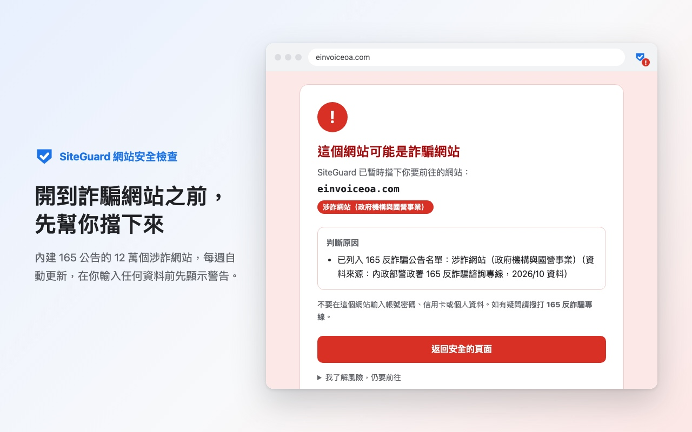
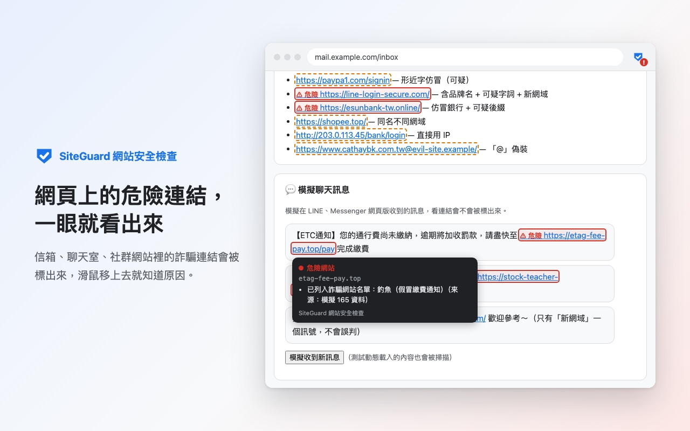

  

<h1 align="center">SiteGuard 網站安全檢查</h1>

  開網站之前先幫你看一眼：辨識詐騙、仿冒與可疑網站的 Chrome 擴充功能。 
  內建內政部警政署 165 反詐騙諮詢專線公告的 12 萬個涉詐網站，所有判斷都在你的電腦上完成。

  <a href="#安裝">安裝</a> ·
  <a href="#隱私">隱私</a> ·
  <a href="#常見問題">常見問題</a> ·
  <a href="https://github.com/casperch100/SiteGuard/issues/new/choose">回報問題</a> ·
  <a href="https://casperch100.github.io/SiteGuard/">隱私權政策</a>

---

> **測試版**：SiteGuard 目前處於小範圍試用階段。對「165 名單以外的新詐騙網站」，辨識能力仍在改善中（進度見 [ROADMAP](ROADMAP.md)）。**沒有警告不代表網站一定安全**，遇到可疑情況請撥打 **165 反詐騙諮詢專線**。

## 功能

  

- **擋下危險網站**：前往 165 公告的涉詐網站，或明顯仿冒官方的網站時，先顯示警告頁，讓你在輸入任何資料前停下來。
- **工具列即時顯示安全狀態**：`✓` 可信任網站、`?` 可疑、`!` 危險。
- **標出網頁上的危險連結**：在網頁、網頁版信箱或聊天室裡，危險連結加紅框、可疑連結加橘色虛線框；滑鼠移上去就會顯示原因。
- **右鍵檢查**：對連結或一段網址按右鍵，選「用 SiteGuard 檢查」。
- **一鍵回報**：覺得網站有問題就回報，之後再遇到同一個網站會直接提醒你（回報只存在你的電腦上）。
- **看得懂的原因**：每個判斷都附上原因，例如「已列入 165 反詐騙公告名單：涉詐網站（運輸倉儲）」，不只是一個紅燈。

  

## 安裝

**Chrome 線上應用程式商店**：準備上架中，上架後會在這裡提供連結。

**先行試用（開發人員模式）**：

1. 下載這個專案：按本頁上方綠色的「**Code**」→「**Download ZIP**」，解壓縮。
2. 在 Chrome 網址列輸入 `chrome://extensions`。
3. 開啟右上角的「**開發人員模式**」。
4. 按「**載入未封裝項目**」，選擇解壓縮後的資料夾。

需要 Chrome 114 以上。

## 怎麼判斷

1. **165 公告的涉詐網站名單**：內建內政部警政署公開的「遭停止解析涉詐網站」等資料，超過 12 萬個網域，涵蓋假投資、假購物、假冒物流與政府機關等類型，每週自動更新。
2. **常見的仿冒手法**：不在名單上的網站，也會用規則辨識，例如形近字仿冒官方網址（把 `l` 換成 `1`）、網址含有銀行或購物網站的名稱但不是官方網站、用「@」偽裝網址、詐騙網站常用的網域後綴等。
3. **你自己的回報**：你回報過的網站，之後都會直接警告。

## 隱私

- **所有判斷都在你的電腦上完成。** SiteGuard 不會上傳你瀏覽的網址，不使用任何分析或廣告服務，也不收集個人資料。
- **唯一的對外連線**：每週從政府資料開放平臺（`opdadm.moi.gov.tw`）下載公開的詐騙網站名單。這是單純的檔案下載，不會傳送你的任何資料。
- 只讀取網頁上**連結的網址**，不讀取文章、表單或帳號密碼等其他內容。

完整說明請看[隱私權政策](https://casperch100.github.io/SiteGuard/)。

## 常見問題

**這些網站不是已經被政府封鎖了嗎？為什麼還需要 SiteGuard？**
名單上的網域大多已被政府「停止解析」。使用台灣電信業者 DNS 的人連過去，會看到政府的封鎖頁。但如果你使用 Google、Cloudflare 等國外 DNS，在 Chrome 開啟「安全 DNS」並指定國外服務、使用 VPN，或人在國外，就可能繞過這個封鎖。我們抽樣檢查，約四成的名單網域透過國外 DNS 仍然連得到。SiteGuard 在瀏覽器裡再擋一次，而且會告訴你原因。

**SiteGuard 說某個正常網站有問題，怎麼辦？**
請[回報誤判](https://github.com/casperch100/SiteGuard/issues/new?template=false-positive.yml)。在警告頁可以選「我了解風險，仍要前往」，本次瀏覽期間就不會再攔截該網站。

**沒有跳出警告，就代表網站安全嗎？**
不是。新的詐騙網站可能還沒被列入任何名單，規則也不一定抓得到。輸入帳號密碼、信用卡或轉帳前，請再三確認網址；有疑問請撥打 165。

**SiteGuard 是政府的產品嗎？**
不是。SiteGuard 是個人開發的開源專案，使用政府公開的資料，判斷結果僅供參考，不代表政府機關的立場。

## 回報與參與

- **回報誤判**（正常網站被警告）：[開啟回報](https://github.com/casperch100/SiteGuard/issues/new?template=false-positive.yml)
- **回報漏抓的詐騙網站**：[開啟回報](https://github.com/casperch100/SiteGuard/issues/new?template=missed-scam.yml)。如果你已經受騙，請先撥打 **165**
- **程式錯誤或建議**：[開啟回報](https://github.com/casperch100/SiteGuard/issues/new?template=bug.yml)
- **安全性問題**：請依照 [SECURITY.md](SECURITY.md) 私下回報，不要公開張貼

想參與開發，請看[開發文件](docs/DEVELOPMENT.md)與[發展計畫](ROADMAP.md)。版本變更紀錄見 [CHANGELOG](CHANGELOG.md)。

## 資料來源與授權

- 程式碼以 [MIT 授權條款](LICENSE) 釋出。
- 詐騙網站名單來自**內政部警政署 165 反詐騙諮詢專線**的公開資料（[遭停止解析涉詐網站](https://data.gov.tw/dataset/176455)、[假投資(博弈)網站](https://data.gov.tw/dataset/160055)），依[政府資料開放授權條款第 1 版](https://data.gov.tw/license)使用，不適用 MIT 授權。
